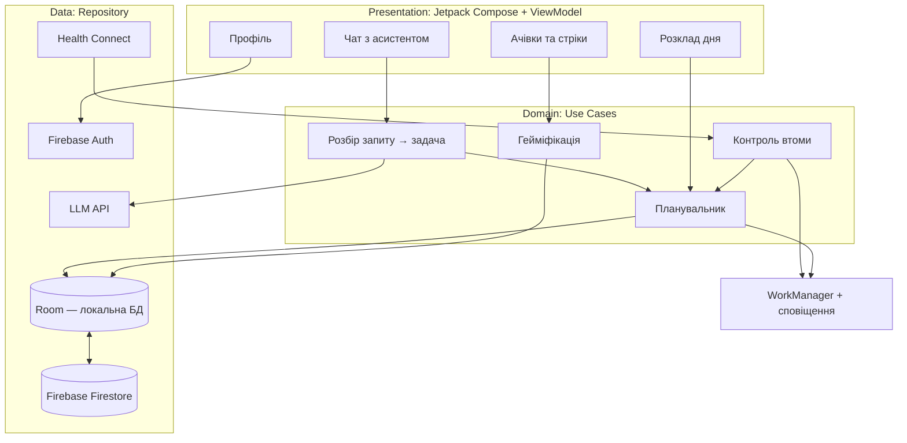

Лабораторна робота з курсу «Програмування мобільних додатків». 
Автор: Лукічова Катерина

# LifeBuddy — особистий AI-менеджер

Android-застосунок для профілактики вигорання у студентів та молодих спеціалістів, які поєднують навчання й роботу.
**Галузь:** медицина (ментальне здоров'я, HealthTech).

## Ідея

Багатозадачність, хаос у справах і відсутність відпочинку ведуть до вигорання. LifeBuddy — це AI-асистент у форматі чату, який:

- зберігає **фіксований розклад** навчання та роботи;
- **автоматично розподіляє** побутові та гнучкі задачі у вільний час з урахуванням навантаження;
- **відстежує ознаки перевтоми** і вчасно пропонує відпочинок;
- мотивує через **стріки та ачівки**.

Задачі додаються природною мовою: *«завтра після пар купити продукти, хвилин 30»*.

> LifeBuddy не є медичним засобом і не замінює консультацію фахівця.

## Функціональні вимоги

1. Реєстрація та вхід (Firebase Auth).
2. Онбординг через чат і формування профілю користувача (розклад, сон, звички).
3. Додавання задач природною мовою з розбором через LLM та підтвердженням користувачем.
4. Автоматичне планування гнучких задач навколо фіксованих блоків з урахуванням навантаження.
5. Контроль втоми: аналіз щільності розкладу та (за згодою) даних Health Connect, пропозиції перерв.
6. Сповіщення про задачі та відпочинок.
7. Гейміфікація: стріки та ачівки.
8. Офлайн-перегляд розкладу з подальшою синхронізацією у Firestore.

## Архітектура (MVVM)

## Технології

Kotlin · Jetpack Compose · MVVM · Room · Firebase (Auth, Firestore) · Retrofit (LLM API) · Health Connect · WorkManager

## Статус

Лабораторна робота №1: налаштування середовища, ідея, архітектура, вимоги.
